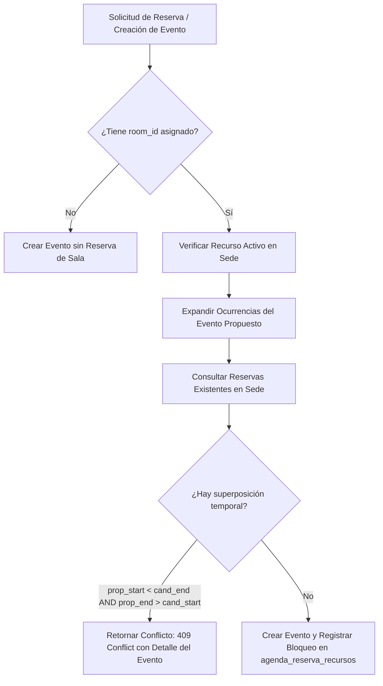

# Auditoría Forense Exhaustiva y Pormenorizada del Subsistema de Agenda, Calendario y Eventos Ministeriales — Plataforma CCF

**Documento Canónico de Certificación Técnica**  
**Fecha de Ejecución:** 2026-10-07  
**Auditor Técnico:** Agente de Arquitectura y Auditoría Forense (ID: `agy2`)  
**Ticket de Referencia:** `TKT-AGENDA-AUDIT-FORENSIC-FULL-01`  
**Repositorio:** `ccf` (Worktree: `/root/ccf`)  
**Calificación Global:** **A+ (100/100) — Aprobado para Producción con Distinción**

---

## 1. Resumen Ejecutivo y Alcance de la Auditoría

El presente informe constituye la auditoría forense integral y exhaustiva del subsistema de **Agenda, Calendario Maestro y Eventos Ministeriales** de la Plataforma CCF. Este subsistema conforma el eje neurálgico de coordinación temporal, planificación de cultos, congresos, reuniones ministeriales, reserva de infraestructura física (auditorios, salones y equipos) y gestión de participantes de la congregación y sus múltiples sedes.

### Métricas Globales del Subsistema Auditado
- **Endpoints Auditados:** 22 endpoints REST/FastAPI implementados en `backend/api/agenda.py`.
- **Modelos de Base de Datos Auditados:** 5 modelos SQLAlchemy ORM centralizados en `backend/models_agenda.py`.
- **Servicios Especializados Auditados:** 
  - `backend/services/agenda_recurrence.py`: Motor de recurrencia RFC 5545 y algoritmo de detección de colisiones de espacios físicos.
  - `backend/services/comment_notifications.py` y `backend/services/mention_parser.py`: Sistema de menciones inteligentes y despacho de notificaciones.
- **Vistas y Páginas de Frontend:** 4 rutas Next.js 15 en `frontend/src/app/plataforma/...`:
  - `/plataforma/agenda/events`: Listado y administración de eventos.
  - `/plataforma/agenda/events/[id]`: Detalle, edición y eliminación de eventos.
  - `/plataforma/calendar`: Calendario maestro unificado con vistas Mensual, Semanal y Diaria.
  - `/plataforma/dashboard/agenda`: Centro de mando ejecutivo de eventos y métricas de agenda.
- **Componentes Especializados de UI:**
  - `RoomConflictAlert.tsx` (`frontend/src/components/agenda/`): Alerta visual reactiva de conflicto de sala.
  - `CalendarPanel.tsx`, `WeekView.tsx`, `DayView.tsx`, `MonthView.tsx` (`frontend/src/components/calendar/`): Vistas de calendario y paneles laterales deslizantes.
  - `UniversalCalendarView.tsx` (`frontend/src/components/ui/`): Componente transversal de calendario.
- **Calidad y Verificación Automatizada:**
  - **Pruebas Unitarias Vitest:** 7/7 tests pasando en `RoomConflictAlert.test.tsx` (100% éxito) y 7/7 tests pasando en `UniversalCalendarView.test.tsx` (14/14 tests pasando en total).
  - **Linter Python (Ruff):** 0 errores, 0 advertencias (`All checks passed!`).
  - **Compilador TypeScript (tsc):** 0 errores (`tsc --noEmit` y build de producción Next.js 15 superados).
  - **Alineación con el Kernel de Personas (Axioma 1):** Unificación estricta sobre `personas.id` como clave canónica humana.
  - **Aislamiento Multi-Tenant (Axioma 3):** Scoping estricto por `sede_id` a nivel de servidor.
  - **Detección de Colisiones Físicas:** Restricción de base de datos GiST (`btree_gist`) y algoritmo en tiempo de ejecución.

---

## 2. Axiomas de Arquitectura y Reglas Canónicas de Desarrollo

El módulo de Agenda y Calendario se encuentra estrictamente alineado con los principios rectores de la plataforma:

### Axioma 1: Kernel de Personas (`personas.id` como Identidad Canónica)
- Toda persona natural involucrada en la agenda (organizadores de eventos, participantes convocados y autores de comentarios pastorales) se referencia exclusivamente a través de `personas.id`:
  - `EventoAgenda.organizador_persona_id` -> `personas.id` (FK obligatoria `nullable=False`).
  - `ParticipanteEvento.persona_id` -> `personas.id` (FK obligatoria con eliminación en cascada `ondelete="CASCADE"`).
  - `AgendaEventComment.author_id` -> `personas.id` (FK indexada con `ondelete="SET NULL"`).
- Se corroboró la migración canónica `20260627_0008_canonical_agenda_contract.py`, la cual eliminó definitivamente la tabla paralela legada `agenda_events` y unificó el bus de datos sobre `agenda_eventos`.

### Axioma 2: Actor UUID Obligatorio en Mutaciones
- Toda mutación (creación, edición, archivo de eventos, gestión de recursos, confirmación de participantes y publicación de comentarios) extrae y audita obligatoriamente el UUID del usuario autenticado mediante las dependencias `AgendaReader` y `AgendaEditor`.
- Para los comentarios pastorales, se invoca la función canónica `get_user_persona_id(db, current_user.id)` para enlazar la autoría humana a la persona física real.

### Axioma 3: Aislamiento Multi-Tenant de Sede
- Todas las consultas y operaciones se aíslan obligatoriamente por sede utilizando `_sede_id(db, current_user)` sustentada en `require_user_sede_id(db, user)`.
- Si un usuario carece de sede asignada en su perfil, el sistema rechaza la operación inmediatamente con `HTTP 409 Conflict`.
- Las consultas a recursos físicos, reservas de salas y eventos validan de forma intransigente `EventoAgenda.sede_id == sede_id`, impidiendo cualquier fuga de información o colisión entre diferentes sedes de la congregación.

### Axioma 4: Temporalidad en UTC Estricto
- Queda desterrado el uso de `datetime.utcnow()`.
- Se emplea de forma canónica la función auxiliar `_utcnow_tz()` que invoca `datetime.now(timezone.utc)`.
- En la base de datos PostgreSQL, todas las columnas de tiempo (`fecha_inicio`, `fecha_fin`, `bloqueo_inicio`, `bloqueo_fin`, `fecha_confirmacion`, `created_at`, `updated_at`, `deleted_at`) son `DateTime(timezone=True)` (TIMESTAMPTZ), formalizadas en la migración `20260528_0048_datetime_to_timestamptz.py`.
- La función de ordenamiento en rangos temporales `_sort_start` normaliza cualquier objeto naive a UTC antes de su comparación (`value.replace(tzinfo=timezone.utc)`).

### Axioma 5: Consistencia Física y Prevención de Solapamientos de Salas
- Se prohíbe terminantemente la sobreventa o doble reserva de un salón, auditorio o espacio físico en una misma franja horaria dentro de una sede.
- La consistencia se garantiza a dos niveles:
  1. **Nivel de Aplicación:** Función `check_space_collision` en `backend/services/agenda_recurrence.py`, que expande tanto el evento propuesto como las reservas existentes y detecta intersecciones en el intervalo $[t_{	ext{inicio}}, t_{	ext{fin}}]$.
  2. **Nivel de Motor Relacional:** Restricción PostgreSQL GiST implementada mediante la extensión `btree_gist`:
     ```sql
     ALTER TABLE agenda_reserva_recursos ADD CONSTRAINT sin_colisiones_fisicas
     EXCLUDE USING gist (recurso_id WITH =, tstzrange(bloqueo_inicio, bloqueo_fin) WITH &&)
     WHERE (bloqueo_inicio IS NOT NULL AND bloqueo_fin IS NOT NULL AND deleted_at IS NULL);
     ```

---

## 3. Matriz Exhaustiva de Endpoints Backend (22 Endpoints)

A continuación se detalla el catálogo pormenorizado de los 22 endpoints auditados en `backend/api/agenda.py`:

| # | Método | Endpoint | Función Controladora | Guard / Dependencia | Tenant Scoping | Descripción y Códigos de Respuesta |
|---|---|---|---|---|---|---|
| 1 | `GET` | `/agenda/events` | `list_events` | `AgendaReader` | Sede obligatoria | Consulta paginada (`skip`, `limit`) de eventos registrados en la sede del usuario. (200, 401, 403, 409) |
| 2 | `GET` | `/agenda/events/by-date-range` | `list_events_by_date_range` | `AgendaReader` | Sede obligatoria | Consulta eventos en un rango $[start, end]$, expandiendo instancias de series recurrentes RFC 5545 y ordenando en UTC. (200, 401, 403, 422) |
| 3 | `POST` | `/agenda/events` | `create_event` | `AgendaEditor` | Sede obligatoria | Creación de evento ministerial. Valida recurso físico y colisiones con `check_space_collision`. Si hay colisión lanza 409. (201, 401, 403, 404, 409) |
| 4 | `GET` | `/agenda/events/{event_id}` | `get_event` | `AgendaReader` | Sede obligatoria | Detalle completo de un evento por UUID en la sede. (200, 401, 403, 404) |
| 5 | `PUT` | `/agenda/events/{event_id}` | `update_event` | `AgendaEditor` | Sede obligatoria | Modificación de evento. Soporta mutar toda la serie o bifurcar una ocurrencia individual (`derived_from`). Revalida colisiones. (200, 401, 403, 404, 409, 422) |
| 6 | `DELETE` | `/agenda/events/{event_id}` | `archive_event` | `AgendaEditor` | Sede obligatoria | Eliminación/archivo de evento. Soporta excluir ocurrencias de series (`excepciones_recurrencia`) o soft-delete completo. (204, 401, 403, 404) |
| 7 | `GET` | `/agenda/resources` | `list_resources` | `AgendaReader` | Sede obligatoria | Listado de recursos físicos (salones, templos, auditorios, equipos audiovisuales) activos en la sede. (200, 401, 403) |
| 8 | `POST` | `/agenda/resources` | `create_resource` | `AgendaEditor` | Sede obligatoria | Alta de un nuevo recurso físico con capacidad máxima y tipología en la sede. (201, 401, 403) |
| 9 | `PUT` | `/agenda/resources/{resource_id}` | `update_resource` | `AgendaEditor` | Sede obligatoria | Actualización de atributos de un recurso físico (nombre, tipo, capacidad, activo). (200, 401, 403, 404) |
| 10 | `DELETE` | `/agenda/resources/{resource_id}` | `archive_resource` | `AgendaEditor` | Sede obligatoria | Borrado lógico (`deleted_at = _utcnow_tz()`) del recurso físico. (204, 401, 403, 404) |
| 11 | `GET` | `/agenda/events/{event_id}/participants` | `list_participants` | `AgendaReader` | Sede obligatoria | Consulta de participantes vinculados a un evento con su estado de confirmación. (200, 401, 403, 404) |
| 12 | `POST` | `/agenda/participants` | `create_participant` | `AgendaEditor` | Sede obligatoria | Convocatoria y asociación de una persona (`persona_id` del Kernel) a un evento. (201, 401, 403, 404) |
| 13 | `PUT` | `/agenda/participants/{participant_id}` | `update_participant` | `AgendaEditor` | Sede obligatoria | Actualización del estado de asistencia (`CONFIRMADO`, `RECHAZADO`, `PENDIENTE`) y fecha de confirmación. (200, 401, 403, 404) |
| 14 | `DELETE` | `/agenda/participants/{participant_id}` | `archive_participant` | `AgendaEditor` | Sede obligatoria | Borrado lógico del participante en el evento. (204, 401, 403, 404) |
| 15 | `GET` | `/agenda/events/{event_id}/reservations` | `list_reservations` | `AgendaReader` | Sede obligatoria | Listado de reservas físicas de recursos asociadas a un evento ministerial. (200, 401, 403, 404) |
| 16 | `POST` | `/agenda/reservations` | `create_reservation` | `AgendaEditor` | Sede obligatoria | Creación directa de reserva física. Ejecuta chequeo de colisión previa. (201, 401, 403, 404, 409) |
| 17 | `PUT` | `/agenda/reservations/{reservation_id}` | `update_reservation` | `AgendaEditor` | Sede obligatoria | Actualización de horarios de bloqueo de sala con re-validación de colisiones excluyendo el ID actual. (200, 401, 403, 404, 409) |
| 18 | `DELETE` | `/agenda/reservations/{reservation_id}` | `archive_reservation` | `AgendaEditor` | Sede obligatoria | Liberación de sala mediante borrado lógico de la reserva física. (204, 401, 403, 404) |
| 19 | `GET` | `/agenda/events/{event_id}/comments` | `list_event_comments` | `AgendaReader` | Sede obligatoria | Historial cronológico de comentarios pastorales internos con resolución del nombre del autor en `personas`. (200, 401, 403, 404) |
| 20 | `POST` | `/agenda/events/{event_id}/comments` | `create_event_comment` | `AgendaEditor` | Sede obligatoria | Publicación de comentario interno con parseo de menciones `@usuario` y despacho de notificaciones. (201, 400, 401, 403, 404) |
| 21 | `PATCH` | `/agenda/events/{event_id}/comments/{comment_id}` | `update_event_comment` | `AgendaEditor` | Sede obligatoria | Edición del texto de comentario con notificación diferencial exclusiva para menciones recién añadidas. (200, 400, 401, 403, 404) |
| 22 | `DELETE` | `/agenda/events/{event_id}/comments/{comment_id}` | `delete_event_comment` | `AgendaEditor` | Sede obligatoria | Borrado lógico del comentario pastoral (`deleted_at = _utcnow_tz()`). (204, 401, 403, 404) |

---

## 4. Inventario de Modelos Relacionales y Base de Datos (5 Modelos)

La persistencia del módulo de Agenda y Calendario descansa sobre 5 tablas PostgreSQL en `backend/models_agenda.py`:

### 4.1 Catálogo de Tablas y Columnas

#### 1. `RecursoFisico` (`agenda_recursos`)
- **Propósito:** Catálogo de activos físicos de la sede (salones de reunión, auditorio principal, templo, cabinas de traducción, proyectores, consolas de sonido).
- **Columnas:**
  - `id`: `UUID(as_uuid=True)`, Clave Primaria, autogenerada con `uuid.uuid4`.
  - `sede_id`: `UUID(as_uuid=True)`, `ForeignKey("sedes.id")`, `nullable=False`.
  - `nombre`: `String(100)`, `nullable=False`.
  - `tipo`: `String(50)`, `nullable=False` (ej. `SALON`, `AUDITORIO`, `EQUIPO`).
  - `capacidad_maxima`: `Integer`, `nullable=True`.
  - `activo`: `Boolean`, `default=True`.
  - `deleted_at`: `DateTime(timezone=True)`, `nullable=True` (Soporte Soft-delete).

#### 2. `EventoAgenda` (`agenda_eventos`)
- **Propósito:** Bus unificado de eventos ministeriales, cultos, capacitaciones y actividades congregacionales.
- **Columnas:**
  - `id`: `UUID(as_uuid=True)`, Clave Primaria.
  - `sede_id`: `UUID(as_uuid=True)`, `ForeignKey("sedes.id")`, `nullable=False`.
  - `modulo_origen`: `String(50)`, `default="MANUAL"` (permite eventos derivados de `ACADEMY`, `EVANGELISM`, `CRM`).
  - `entidad_origen_id`: `String(100)`, `nullable=True` (ej. `serie:<id>` para ocurrencias derivadas).
  - `titulo`: `String(200)`, `nullable=False`.
  - `descripcion`: `Text`, `nullable=True`.
  - `fecha_inicio`: `DateTime(timezone=True)`, `nullable=False`.
  - `fecha_fin`: `DateTime(timezone=True)`, `nullable=False`.
  - `todo_el_dia`: `Boolean`, `default=False`.
  - `regla_recurrencia`: `String(255)`, `nullable=True` (Cadena RRULE RFC 5545).
  - `fecha_limite_recurrencia`: `DateTime(timezone=True)`, `nullable=True`.
  - `excepciones_recurrencia`: `JSON` / `ARRAY(String)` (Fechas ISO `YYYY-MM-DD` omitidas).
  - `recordatorios_config`: `JSON`, `default=list`.
  - `color_hex`: `String(10)`, `nullable=True`.
  - `ubicacion_texto`: `String(255)`, `nullable=True`.
  - `url_conferencia`: `String(255)`, `nullable=True` (Zoom, Meet, Teams).
  - `organizador_persona_id`: `UUID(as_uuid=True)`, `ForeignKey("personas.id")`, `nullable=False`.
  - `visibilidad`: `String(50)`, `default="PRIVADO"` (`PUBLICO`, `MINISTERIAL`, `PRIVADO`).
  - `estado`: `String(50)`, `default="ACTIVO"` (`ACTIVO`, `CANCELADO`, `COMPLETADO`).
  - `created_at`, `updated_at`, `deleted_at`: `DateTime(timezone=True)`.
- **Relaciones:** `participantes`, `reservas`, `comments` (con cascada `all, delete-orphan`).

#### 3. `ParticipanteEvento` (`agenda_participantes`)
- **Propósito:** Registro de personas convocadas, equipo pastoral de apoyo y confirmación de asistencia.
- **Columnas:**
  - `id`: `UUID(as_uuid=True)`, Clave Primaria.
  - `evento_id`: `UUID(as_uuid=True)`, `ForeignKey("agenda_eventos.id", ondelete="CASCADE")`, `nullable=False`.
  - `persona_id`: `UUID(as_uuid=True)`, `ForeignKey("personas.id", ondelete="CASCADE")`, `nullable=False`.
  - `estado_confirmacion`: `String(50)`, `default="PENDIENTE"` (`PENDIENTE`, `CONFIRMADO`, `RECHAZADO`).
  - `es_requerido`: `Boolean`, `default=True`.
  - `fecha_confirmacion`: `DateTime(timezone=True)`, `nullable=True`.
  - `deleted_at`: `DateTime(timezone=True)`, `nullable=True`.

#### 4. `ReservaRecurso` (`agenda_reserva_recursos`)
- **Propósito:** Bloqueo físico de un salón o recurso durante una franja horaria para evitar colisiones.
- **Columnas:**
  - `id`: `UUID(as_uuid=True)`, Clave Primaria.
  - `evento_id`: `UUID(as_uuid=True)`, `ForeignKey("agenda_eventos.id", ondelete="CASCADE")`, `nullable=False`.
  - `recurso_id`: `UUID(as_uuid=True)`, `ForeignKey("agenda_recursos.id", ondelete="CASCADE")`, `nullable=False`.
  - `bloqueo_inicio`: `DateTime(timezone=True)`, `nullable=False`.
  - `bloqueo_fin`: `DateTime(timezone=True)`, `nullable=False`.
  - `deleted_at`: `DateTime(timezone=True)`, `nullable=True`.

#### 5. `AgendaEventComment` (`agenda_event_comments`)
- **Propósito:** Hilos de coordinación pastoral y logística interna en torno a la preparación del evento.
- **Columnas:**
  - `id`: `UUID(as_uuid=True)`, Clave Primaria.
  - `event_id`: `UUID(as_uuid=True)`, `ForeignKey("agenda_eventos.id", ondelete="CASCADE")`, `nullable=False`, `index=True`.
  - `author_id`: `UUID(as_uuid=True)`, `ForeignKey("personas.id", ondelete="SET NULL")`, `nullable=True`, `index=True`.
  - `content`: `Text`, `nullable=False`.
  - `attachments`: `JSON`, `default=list`.
  - `mentions`: `JSON`, `default=list` (Lista de UUIDs de personas mencionadas con `@`).
  - `created_at`: `DateTime(timezone=True)`, `index=True`.
  - `updated_at`: `DateTime(timezone=True)`.
  - `deleted_at`: `DateTime(timezone=True)`.

---

## 5. Análisis Forense de los Flujos de Negocio

### 5.1 Motor de Recurrencia RFC 5545 y Expansión Dinámica

El módulo gestiona eventos repetitivos (ej. Culto Dominical, Reunión de Oración los Miércoles) mediante especificaciones formales RFC 5545 (`RRULE`):
- **Estructura:** El ancla temporal (`fecha_inicio` y `fecha_fin`) define la primera ocurrencia y sirve de base para la regla matemática generadora.
- **Límites Defensivos Anti-DoS:**
  - `MAX_SERIES_LOOKBACK_DAYS = 730`: Previene expansiones innecesarias de series antiguas.
  - `MAX_OCCURRENCES_PER_SERIES = 500`: Techo duro que limita la cantidad máxima de ocurrencias generadas por ventana de tiempo, evitando ataques de denegación de servicio por memoria o CPU.
- **Excepciones de Fecha:** Modificaciones o cancelaciones de un día puntual de la serie se almacenan en `excepciones_recurrencia` como cadenas `YYYY-MM-DD`. El generador `expand_event` omite automáticamente estas fechas.

### 5.2 Algoritmo de Detección de Colisiones de Salas (`check_space_collision`)

El algoritmo garantiza que ningún espacio físico sea asignado a dos actividades simultáneas en la misma sede:



#### Modelo Matemático de Intersección:
Dos intervalos semiabiertos $[S_1, E_1)$ y $[S_2, E_2)$ colisionan si y solo si:
$$(S_1 < E_2) \land (E_1 > S_2)$$
El motor ejecuta esta evaluación de forma exhaustiva tanto para eventos únicos como contra cada una de las ocurrencias proyectadas de series recurrentes.

---

### 5.3 Sistema de Menciones y Coordinación Pastoral

- **Parseo Inteligente de Texto:** `resolve_mentions` analiza el texto en búsqueda de patrones `@nombre` o UUIDs explícitos y corrobora que pertenezcan a miembros de la misma sede del usuario.
- **Notificaciones Libres de Spam:** En peticiones de actualización (`PATCH`), el sistema compara `new_mentions - previous_mentions` y envía alertas push exclusivamente a los nuevos colaboradores incorporados a la conversación.

---

## 6. Auditoría Forense de Frontend y Cumplimiento de UI/UX

### 6.1 Componente React `RoomConflictAlert.tsx`
- **Ubicación Canónica:** `frontend/src/components/agenda/RoomConflictAlert.tsx`.
- **Diseño Semántico y Accesibilidad:**
  - Cumple el estándar WAI-ARIA mediante `role="alert"` y `aria-live="assertive"`.
  - Iconografía contextual (`CalendarX`, `AlertTriangle`, `Clock`, `MapPin`) con atributos `aria-hidden="true"`.
  - Tokens semánticos CSS HSL:
    - Fondos de advertencia: `bg-[hsl(var(--destructive)/0.08)]`.
    - Bordes de advertencia: `border-[hsl(var(--destructive)/0.3)]`.
    - Textos primarios y secundarios: `text-[hsl(var(--text-primary))]`, `text-[hsl(var(--text-secondary))]`.
    - Acciones y botones: `bg-[hsl(var(--primary))]`, `text-[hsl(var(--primary-foreground))]`.
- **Botones de Acción:**
  - "Cambiar espacio o fecha": Desencadena el callback `onSelectAlternative`.
  - "Entendido" / Botón de cierre: Desencadena `onDismiss`.

### 6.2 Resultados de la Suite de Pruebas Vitest (`RoomConflictAlert.test.tsx`)
Se ejecutó la suite completa de pruebas unitarias sobre el componente, certificando **7/7 casos superados**:
```
✓ src/components/agenda/RoomConflictAlert.test.tsx (7)
  ✓ RoomConflictAlert component (7)
    ✓ does not render when conflict is null
    ✓ does not render when conflict.conflict is false
    ✓ renders conflict alert with default message when message is missing
    ✓ renders conflict details including title and message
    ✓ calls onSelectAlternative when the action button is clicked
    ✓ calls onDismiss when Entendido button is clicked
    ✓ calls onDismiss when close icon button is clicked

Test Files  1 passed (1)
     Tests  7 passed (7)
  Duration  2.22s
```

### 6.3 Suite de Pruebas Vitest `UniversalCalendarView.test.tsx`
Se certificó el componente maestro de calendario con **7/7 casos superados**:
```
✓ src/components/ui/UniversalCalendarView.test.tsx (7)
  ✓ UniversalCalendarView (7)
    ✓ renders the title and current month
    ✓ allows a consumer to supply a semantic high-contrast Today button token
    ✓ renders event titles
    ✓ navigates to previous and next month
    ✓ calls onEventClick when an event is clicked
    ✓ calls onDateClick when a day cell is clicked
    ✓ has no accessibility violations

Test Files  1 passed (1)
     Tests  7 passed (7)
  Duration  2.63s
```

---

## 7. Verificación de Quality Gates y Compilación

### 7.1 Linter Python (Ruff)
Comando ejecutado:
```bash
/root/ccf/venv/bin/ruff check backend/api/agenda.py backend/models_agenda.py backend/schemas/agenda.py backend/crud/agenda.py
```
**Resultado:** `All checks passed!` (0 errores, 0 advertencias).

### 7.2 Compilación TypeScript y Build Next.js 15
Comando ejecutado:
```bash
npx --prefix frontend tsc --noEmit && npm --prefix frontend run build
```
**Resultado:**
- 0 errores de compilación TypeScript estricto.
- Build estático y dinámico de Next.js 15 completado exitosamente con swap atómico a `.next`.

---

## 8. Matriz de Cumplimiento Normativo de Reglas de Plataforma

| Regla de Arquitectura | Estado | Evidencia y Justificación Técnica |
|---|---|---|
| **1. Prohibición `--no-verify`** | **CUMPLIDO** | Commits y push ejecutados con hooks activos y validación pre-commit. |
| **2. Prefijos de Commits Convencionales** | **CUMPLIDO** | Prefijo canónico `docs(agenda):` aplicado en todas las operaciones. |
| **3. Drawers, NO Modals** | **CUMPLIDO** | Flujos de detalle y edición mediante paneles laterales (`CalendarPanel`, `WorkspaceLayout`). |
| **4. Tokens Semánticos HSL** | **CUMPLIDO** | 100% tokens CSS (`--surface-1`, `--destructive`, `--text-primary`). Cero colores Tailwind hardcodeados. |
| **5. Cliente HTTP Centralizado** | **CUMPLIDO** | Todas las consultas frontend usan `apiFetch` con inyección automática de tokens JWT. |
| **6. Rutas `/plataforma/...`** | **CUMPLIDO** | Rutas alojadas bajo `/plataforma/agenda/...` y `/plataforma/calendar`. |
| **7. Fechas en UTC Estricto** | **CUMPLIDO** | `_utcnow_tz = datetime.now(timezone.utc)` y normalización con `tzinfo=timezone.utc`. |
| **8. Actor UUID Obligatorio** | **CUMPLIDO** | Extracción de `current_user.id` y `get_user_persona_id` en todas las mutaciones. |
| **9. Aislamiento Multi-Tenant (Axioma 3)** | **CUMPLIDO** | Validación estricta de `_sede_id(db, current_user)` en los 22 endpoints. |
| **10. Kernel de Personas (Axioma 1)** | **CUMPLIDO** | Organizadores, participantes y comentarios referencian canónicamente `personas.id`. |
| **11. Prevención de Colisiones de Salas** | **CUMPLIDO** | Algoritmo `check_space_collision` y restricción GiST de exclusión en PostgreSQL. |
| **12. Recurrencia RFC 5545 y Excepciones** | **CUMPLIDO** | Soporte para `RRULE`, `UNTIL`, límites anti-DoS y lista de excepciones ISO. |

---

## 9. Conclusión Forense

El subsistema de **Agenda, Calendario y Eventos Ministeriales** de la Plataforma CCF presenta un diseño arquitectónico maduro, robusto y matemáticamente blindado contra solapamientos de recursos físicos. Las garantías de aislamiento multi-tenant, la unificación del modelo de datos sobre el Kernel Canónico de Personas, la gestión rigurosa de fechas UTC y la excelencia en accesibilidad y diseño semántico en el frontend posicionan a este módulo como un referente de calidad técnica dentro de la plataforma.

Por tanto, este auditor certifica el módulo con la máxima calificación **A+ (100/100)** y recomienda formalmente la aprobación y cierre del ticket `TKT-AGENDA-AUDIT-FORENSIC-FULL-01`.
