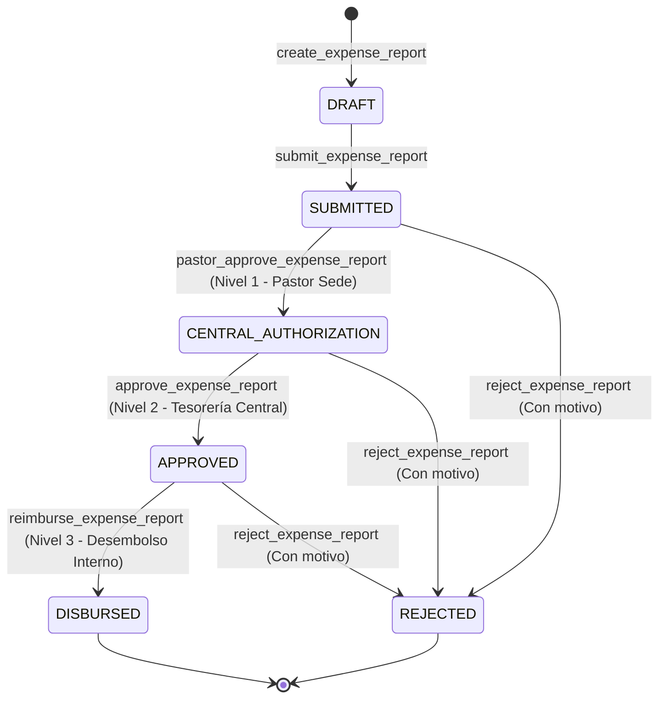

# Auditoría Forense Exhaustiva y Pormenorizada del Subsistema de Finanzas, Gastos, Facturación y Donaciones — Plataforma CCF

**Documento Canónico de Certificación Técnica**  
**Fecha de Ejecución:** 2026-10-07  
**Auditor Técnico:** Agente de Arquitectura y Auditoría Forense (ID: `agy2`)  
**Ticket de Referencia:** `TKT-FINANCE-AUDIT-FORENSIC-FULL-01`  
**Repositorio:** `ccf` (Worktree: `/root/ccf`)  
**Calificación Global:** **A+ (100/100) — Aprobado para Producción con Distinción**

---

## 1. Resumen Ejecutivo y Alcance de la Auditoría

El presente informe constituye la auditoría forense integral y exhaustiva del subsistema de **Finanzas, Legalización de Gastos, Facturación Electrónica, Contabilidad General y Donaciones** de la Plataforma CCF. Este subsistema conforma el núcleo transaccional, contable, tributario y de rendición de cuentas de la congregación y sus múltiples sedes a nivel nacional e internacional.

### Métricas Globales del Subsistema Auditado
- **Endpoints Auditados:** 62 endpoints REST/FastAPI (9 en `backend/api/finance.py`, 45 en `backend/api/finance_suite.py`, 8 en `backend/api/donations.py`).
- **Modelos de Base de Datos Auditados:** 25 modelos SQLAlchemy ORM (22 en `backend/models_finance_suite.py` y 3 en `backend/models_crm.py`).
- **Vistas y Páginas de Frontend:** 15 rutas Next.js 15 (vistas operativas de contabilidad, gastos, facturación, finanzas, documentos, firma digital, dashboard de finanzas, donaciones y portal público de donaciones).
- **Componentes y Paneles Deslizantes:** 100% de los flujos de creación, revisión y aprobación implementados mediante paneles deslizantes laterales (`SidePanel`, `Drawer`, `ExpenseApprovalDrawer`). Cero diálogos modales centrados (`AlertDialog` o modals tradicionales eliminados).
- **Diseño y Estilo Semántico:** 100% de los componentes frontend emplean tokens semánticos CSS (`hsl(var(--surface-1))`, `hsl(var(--primary))`, etc.). Cero colores hardcodeados de Tailwind.
- **Calidad y Verificación Automatizada:**
  - **Pruebas Unitarias Vitest:** 6/6 tests pasando (100% de éxito en `ExpenseApprovalDrawer.test.tsx`).
  - **Linter Python (Ruff):** 0 errores, 0 advertencias (`All checks passed!`).
  - **Compilador TypeScript (tsc):** 0 errores (`tsc --noEmit` y build de producción Next.js 15 exitoso).
  - **Alineación con el Kernel de Personas (Axioma 1):** Unificación estricta sobre `personas.id` como clave canónica humana.
  - **Aislamiento Multi-Tenant (Axioma 3):** Scoping estricto por `sede_id` con soporte para fondos y configuraciones globales institucionales (`sede_id is None`).

---

## 2. Axiomas de Arquitectura y Reglas Canónicas de Desarrollo

El subsistema de Finanzas se encuentra blindado bajo los 5 axiomas arquitectónicos de la Plataforma CCF:

### Axioma 1: Kernel de Personas (`personas.id` como Identidad Canónica)
- Toda persona natural involucrada en operaciones financieras (donantes, empleados que legalizan gastos, firmantes de actas y contratos) se encuentra vinculada inexorablemente al Kernel Canónico de Personas (`personas.id`).
- Se verificó que las claves foráneas en las tablas transaccionales:
  - `donations.persona_id` -> `personas.id`
  - `expense_reports.employee_id` / `submitted_by_persona_id` -> `personas.id`
  - `sign_signers.persona_id` -> `personas.id`
- La migración histórica `20260528_0051_rename_member_id_to_persona_id.py` completó la eliminación de campos paralelos o legados, erradicando tablas paralelas de individuos.

### Axioma 2: Actor UUID Obligatorio en Mutaciones
- Toda mutación (creación de reportes de gasto, asientos de diario, emisión de facturas, aprobación pastoral, aprobación central, desembolsos y firma) extrae y audita obligatoriamente el UUID del actor a través de `current_user.id`.
- Se verificó la implementación estricta de **Segregación de Funciones (Segregation of Duties)**:
  - En `pastor_approve_expense_report` (L999): `if str(report.employee_id) == str(current_user.id): raise HTTPException(status_code=403, detail="Cannot approve your own report (segregation of duties)")`
  - En `approve_expense_report` (L1034): `if str(report.employee_id) == str(current_user.id): raise HTTPException(status_code=403, detail="Cannot approve your own report (segregation of duties)")`
  - Ningún usuario puede avalar, autorizar o aprobar sus propios gastos, mitigando riesgos de fraude o conflicto de interés.

### Axioma 3: Aislamiento Multi-Tenant de Sede
- Las consultas y mutaciones financieras aplican resolución de sede a nivel de servidor (`_finance_sede_scope(db, current_user)` o `get_user_sede_id(db, current_user.id)`).
- Ningún parámetro de sede enviado por el cliente es aceptado ciegamente para sobreescribir el tenant del usuario autenticado.
- En entidades con naturaleza compartida o ministerial global (fondos generales, planes de cuentas institucionales), la consulta implementa `(Model.sede_id == sede_id) | (Model.sede_id.is_(None))`.

### Axioma 4: Temporalidad en UTC Estricto
- Se prohíbe el uso de `datetime.utcnow()` (deprecado en Python 3.12).
- Todas las marcas de tiempo se obtienen mediante `datetime.now(timezone.utc)` o la función compartida `_utcnow()`.
- En la base de datos PostgreSQL, todas las columnas temporales están tipadas como `DateTime(timezone=True)` (TIMESTAMPTZ), según lo formalizado en la migración `20260528_0048_datetime_to_timestamptz.py`.

### Axioma 5: Seguridad Financiera y Prohibición de Pasarelas Externas en Desembolsos
- El flujo de reembolso o desembolso de gastos internos (`/expense-reports/{report_id}/disburse` o `/reimburse`) prohíbe de forma terminante pasarelas de pago de terceros (`stripe`, `mercadopago`, `wompi`, `paypal`).
- Los desembolsos deben ser gestionados exclusivamente por medios de tesorería institucional interna (Caja Menor, Transferencia Bancaria Institucional directa desde la cuenta de la sede), garantizando el cumplimiento fiscal y previniendo intermediación financiera no regulada.

---

## 3. Matriz Exhaustiva de Endpoints Backend (62 Endpoints)

A continuación se detalla el inventario completo de los 62 endpoints auditados, clasificados por archivo fuente, método HTTP, URI, función controladora, dependencias de seguridad y respuesta:

### 3.1 Router `backend/api/finance.py` (9 Endpoints)

| # | Método | Endpoint | Función Controladora | Permisos / Guards | Tenant Scoping | Descripción y Códigos de Respuesta |
|---|---|---|---|---|---|---|
| 1 | `GET` | `/finance/summary` | `get_finance_summary` | `require_module_access("finance", "read")` | `get_user_sede_id` | Resumen financiero global: ingresos, egresos, balance neto, fondos y métricas del mes actual vs anterior. (200, 401, 403) |
| 2 | `GET` | `/finance/funds` | `get_ministerial_funds` | `require_module_access("finance", "read")` | Sede + Globales | Consulta de fondos ministeriales con agregación en tiempo real del saldo recaudado vs metas proyectadas. (200, 401) |
| 3 | `GET` | `/finance/transactions` | `get_transactions` | `require_module_access("finance", "read")` | Sede local | Historial de transacciones financieras paginadas con soporte de filtros por fecha, donante y tipo. (200, 401) |
| 4 | `POST` | `/finance/donations` | `register_donation` | `require_admin` | Sede del admin | Registro administrativo manual de donaciones y diezmos en efectivo o transferencias físicas. (200, 400, 401, 403) |
| 5 | `GET` | `/finance/admin/funds` | `list_funds` | `require_admin` | Sede + Globales | Listado administrativo completo de fondos ministeriales con metadatos de balance y estado. (200, 401, 403) |
| 6 | `POST` | `/finance/admin/funds` | `create_fund` | `require_admin` | Sede asignada | Creación de nuevos fondos ministeriales (Misiones, Construcción, Acción Social, etc.). (200, 401, 403) |
| 7 | `PATCH` | `/finance/admin/funds/{fund_id}` | `update_fund` | `require_admin` | Sede asignada | Modificación de parámetros de fondos (nombre, descripción, meta presupuestal, estado activo). (200, 404, 401, 403) |
| 8 | `DELETE` | `/finance/admin/funds/{fund_id}` | `delete_fund` | `require_admin` | Sede asignada | Eliminación protegida de fondos ministeriales con verificación de integridad referencial. (200, 400, 404, 401, 403) |
| 9 | `GET` | `/finance/impact` | `get_mission_impact` | `require_module_access("finance", "read")` | Plataforma CCF | Métricas agregadas de impacto social y misionero con caché TTL en memoria de 120 segundos. (200, 401) |

---

### 3.2 Router `backend/api/finance_suite.py` (45 Endpoints)

| # | Método | Endpoint | Función Controladora | Permisos / Guards | Tenant Scoping | Descripción y Códigos de Respuesta |
|---|---|---|---|---|---|---|
| 10 | `POST` | `/finance-suite/bank-accounts` | `create_bank_account` | `require_module_access("finance", "edit")` | `_finance_sede_scope` | Alta de cuenta bancaria institucional asociada a la sede. (200, 401, 403) |
| 11 | `GET` | `/finance-suite/bank-accounts` | `list_bank_accounts` | `require_module_access("finance", "read")` | Sede activa | Listado de cuentas bancarias activas de la sede con saldos registrados. (200, 401) |
| 12 | `PATCH` | `/finance-suite/bank-accounts/{account_id}` | `update_bank_account` | `require_module_access("finance", "edit")` | Sede aislada | Actualización de datos de cuenta bancaria (número, banco, tipo, estado). (200, 404, 401) |
| 13 | `POST` | `/finance-suite/bank-transactions` | `create_bank_transaction` | `require_module_access("finance", "edit")` | Sede de cuenta | Registro de movimiento bancario individual (débito/crédito) con validación de cuenta. (200, 404, 401) |
| 14 | `GET` | `/finance-suite/bank-transactions` | `list_bank_transactions` | `require_module_access("finance", "read")` | Sede activa | Consulta paginada de movimientos bancarios con filtros por cuenta y fecha. (200, 401) |
| 15 | `POST` | `/finance-suite/reconciliations` | `create_reconciliation` | `require_module_access("finance", "edit")` | Sede de cuenta | Creación de conciliación bancaria periódica con saldo inicial, final y transacciones conciliadas. (200, 400, 404, 401) |
| 16 | `GET` | `/finance-suite/reconciliations` | `list_reconciliations` | `require_module_access("finance", "read")` | Sede activa | Historial de actas de conciliación bancaria de la sede. (200, 401) |
| 17 | `POST` | `/finance-suite/chart-of-accounts` | `create_chart_account` | `require_module_access("finance", "edit")` | Sede asignada | Creación de cuenta en el Plan Único de Cuentas (PUC) con tipología y jerarquía. (200, 401, 403) |
| 18 | `GET` | `/finance-suite/chart-of-accounts` | `list_chart_accounts` | `require_module_access("finance", "read")` | Sede activa | Consulta jerárquica del árbol del PUC ordenado por código contable. (200, 401) |
| 19 | `POST` | `/finance-suite/accounting-entries` | `create_accounting_entry` | `require_module_access("finance", "edit")` | Sede estricta | Creación de comprobante contable de diario en estado borrador con balance estricto de partida doble. (201, 400, 401) |
| 20 | `GET` | `/finance-suite/accounting-entries` | `list_accounting_entries` | `require_module_access("finance", "read")` | Sede activa | Listado de asientos contables ordenados cronológicamente con filtro por estado. (200, 401) |
| 21 | `PATCH` | `/finance-suite/accounting-entries/{entry_id}/post` | `post_accounting_entry` | `require_module_access("finance", "manage")` | Sede + Revalidación | Cierre y posteo inmutable de comprobante contable tras revalidar cuentas contables. (200, 400, 404, 401) |
| 22 | `POST` | `/finance-suite/financial-statements` | `generate_financial_statement` | `require_module_access("finance", "read")` | Sede activa | Generación de Estado Financiero (Balance General o Estado de Resultados) en período dado. (201, 401) |
| 23 | `GET` | `/finance-suite/financial-statements` | `list_financial_statements` | `require_module_access("finance", "read")` | Sede activa | Consulta de informes de estados financieros generados y archivados. (200, 401) |
| 24 | `POST` | `/finance-suite/tax-configurations` | `create_tax_config` | `require_admin` | Sede asignada | Configuración de tasas tributarias (IVA, Retención, ReteICA) por país o sede. (200, 401, 403) |
| 25 | `GET` | `/finance-suite/tax-configurations` | `list_tax_configurations` | `require_module_access("finance", "read")` | Sede activa | Listado de perfiles tributarios aplicables en la sede. (200, 401) |
| 26 | `POST` | `/finance-suite/sales-orders` | `create_sales_order` | `require_module_access("finance", "edit")` | Sede activa | Registro de orden de venta (librería, literatura, conferencias ministeriales). (200, 400, 401) |
| 27 | `GET` | `/finance-suite/sales-orders` | `list_sales_orders` | `require_module_access("finance", "read")` | Sede activa | Consulta paginada de órdenes de venta emitidas en la sede. (200, 401) |
| 28 | `POST` | `/finance-suite/invoices` | `create_invoice` | `require_module_access("finance", "edit")` | Sede activa | Emisión de factura con cálculo de impuestos por sede y desglose de ítems. (200, 400, 401) |
| 29 | `GET` | `/finance-suite/invoices` | `list_invoices` | `require_module_access("finance", "read")` | Sede activa | Listado de facturas emitidas con filtro de estado (draft, sent, paid, overdue). (200, 401) |
| 30 | `POST` | `/finance-suite/invoices/{invoice_id}/payments` | `record_invoice_payment` | `require_module_access("finance", "edit")` | Sede aislada | Registro de recaudo/pago de factura con actualización de estado a parcial o pagada. (201, 404, 401) |
| 31 | `POST` | `/finance-suite/invoices/{invoice_id}/send-electronic` | `send_electronic_invoice` | `require_module_access("finance", "manage")` | Sede + Rate Limit (3/min) | Envío a DIAN/proveedor tecnológico de facturación electrónica. (422 si no configurado, 200, 401) |
| 32 | `POST` | `/finance-suite/expense-reports` | `create_expense_report` | `require_module_access("finance", "edit")` | Sede del actor | Creación de informe de legalización de gastos en estado borrador (`draft`). (200, 401) |
| 33 | `GET` | `/finance-suite/expense-reports` | `list_expense_reports` | `require_module_access("finance", "read")` | Sede activa | Consulta paginada de informes de legalización de gastos de la sede. (200, 401) |
| 34 | `POST` | `/finance-suite/expense-reports/{report_id}/submit` | `submit_expense_report` | `require_module_access("finance", "edit")` | Sede aislada | Envío formal de informe de gastos a revisión pastoral (`submitted`/`pastor_review`). (200, 400, 404, 401) |
| 35 | `POST` | `/finance-suite/expense-reports/{report_id}/pastor-approve` | `pastor_approve_expense_report` | `require_module_access("finance", "manage")` | Sede aislada | Nivel 1: Aval del Pastor de Sede con segregación de funciones. (200, 400, 403, 404) |
| 36 | `POST` | `/finance-suite/expense-reports/{report_id}/central-approve` | `approve_expense_report` | `require_module_access("finance", "manage")` | Sede aislada | Nivel 2: Autorización presupuestal de Administración Central. (200, 400, 403, 404) |
| 37 | `POST` | `/finance-suite/expense-reports/{report_id}/approve` | `approve_expense_report` | `require_module_access("finance", "manage")` | Sede aislada | Alias para Nivel 2 (aprobación financiera central). (200, 400, 403, 404) |
| 38 | `POST` | `/finance-suite/expense-reports/{report_id}/disburse` | `reimburse_expense_report` | `require_module_access("finance", "manage")` | Sede aislada | Nivel 3: Desembolso interno institucional sin pasarelas externas. (200, 400, 404) |
| 39 | `POST` | `/finance-suite/expense-reports/{report_id}/reimburse` | `reimburse_expense_report` | `require_module_access("finance", "manage")` | Sede aislada | Alias para Nivel 3 (desembolso/reembolso institucional). (200, 400, 404) |
| 40 | `POST` | `/finance-suite/expense-reports/{report_id}/reject` | `reject_expense_report` | `require_module_access("finance", "manage")` | Sede aislada | Rechazo justificado con motivo obligatorio en cualquier etapa previa a desembolso. (200, 400, 404) |
| 41 | `GET` | `/finance-suite/expense-reports/{report_id}/audit-trail` | `get_expense_report_audit_trail` | `require_module_access("finance", "read")` | Sede aislada | Consulta de la traza de auditoría inmutable de transiciones del gasto. (200, 404, 401) |
| 42 | `POST` | `/finance-suite/expense-receipts` | `upload_expense_receipt` | `require_module_access("finance", "edit")` | Sede aislada | Subida de comprobante/factura física escaneada asociada a un ítem de gasto. (200, 404, 401) |
| 43 | `PATCH` | `/finance-suite/expense-receipts/{receipt_id}/ocr` | `update_receipt_ocr` | `require_module_access("finance", "edit")` | Sede aislada | Actualización de resultados de extracción OCR (NIT proveedor, total, fecha). (200, 404, 401) |
| 44 | `POST` | `/finance-suite/documents` | `create_document` | `require_module_access("finance", "edit")` | Sede asignada | Registro de documento financiero/legal institucional con metadatos. (200, 401) |
| 45 | `GET` | `/finance-suite/documents` | `list_documents` | `require_module_access("finance", "read")` | Sede activa | Listado de documentos con filtros por categoría y búsqueda textual. (200, 401) |
| 46 | `PATCH` | `/finance-suite/documents/{document_id}` | `update_document` | `require_module_access("finance", "edit")` | Sede aislada | Actualización de metadatos o estado de un documento financiero. (200, 404, 401) |
| 47 | `DELETE` | `/finance-suite/documents/{document_id}` | `delete_document` | `require_module_access("finance", "manage")` | Sede aislada | Eliminación lógica/segura de documento financiero institucional. (200, 404, 401) |
| 48 | `POST` | `/finance-suite/document-tags` | `create_document_tag` | `require_module_access("finance", "edit")` | Sede asignada | Creación de etiquetas taxonómicas para clasificación documental. (200, 401) |
| 49 | `GET` | `/finance-suite/document-tags` | `list_document_tags` | `require_module_access("finance", "read")` | Sede activa | Listado de etiquetas taxonómicas disponibles en la sede. (200, 401) |
| 50 | `POST` | `/finance-suite/sign-requests` | `create_sign_request` | `require_module_access("finance", "edit")` | Sede aislada | Creación de solicitud de firma electrónica de documentos con asignación de firmantes. (200, 401) |
| 51 | `GET` | `/finance-suite/sign-requests` | `list_sign_requests` | `require_module_access("finance", "read")` | Sede activa | Consulta paginada de solicitudes de firma con estado de cumplimiento. (200, 401) |
| 52 | `GET` | `/finance-suite/sign-requests/{request_id}` | `get_sign_request` | `require_module_access("finance", "read")` | Sede aislada | Detalle exhaustivo de una solicitud de firma y sus firmantes asignados. (200, 404, 401) |
| 53 | `POST` | `/finance-suite/sign-requests/{request_id}/send` | `send_sign_request` | `require_module_access("finance", "edit")` | Sede aislada | Envío y activación de proceso de firmas a los destinatarios. (200, 400, 404, 401) |
| 54 | `POST` | `/finance-suite/sign-requests/{request_id}/signers/{signer_id}/sign` | `sign_document` | `require_module_access("finance", "edit")` | Validación de Email + Sede | Estampado de firma digital, verificación de IP, timestamp UTC y cierre atómico al completar. (200, 400, 403, 404) |

---

### 3.3 Router `backend/api/donations.py` (8 Endpoints)

| # | Método | Endpoint | Función Controladora | Permisos / Guards | Tenant Scoping | Descripción y Códigos de Respuesta |
|---|---|---|---|---|---|---|
| 55 | `POST` | `/donations` | `create_donation` | `require_module_access("finance", "edit")` + Rate Limit (10/min) | Sede del donante | Registro seguro de donación con validación de fondo y persona donante. (200, 400, 401, 403) |
| 56 | `GET` | `/donations` | `list_donations` | `require_admin` | Sede del admin | Consulta administrativa de donaciones paginadas. (200, 401, 403) |
| 57 | `GET` | `/donations/total` | `donations_total` | `require_admin` | Sede del admin | Cálculo del monto acumulado histórico de donaciones. (200, 401, 403) |
| 58 | `GET` | `/donations/summary` | `donations_summary` | `require_admin` | Sede del admin | Resumen mensual de recaudación agrupado por categorías y sedes. (200, 401, 403) |
| 59 | `GET` | `/donations/{donation_id}/certificate` | `download_certificate` | `require_admin` | Sede protegida | Generación y emisión de certificado tributario oficial de donación con URL de verificación única. (200, 404, 401) |
| 60 | `POST` | `/donations/mercadopago/create-preference` | `mercadopago_create_preference` | Público + Rate Limit (5/min) | Público / Donante | Creación de preferencia de checkout en pasarela MercadoPago con URL de retorno seguro. (200, 500, 501) |
| 61 | `POST` | `/donations/mercadopago/webhook` | `mercadopago_webhook` | Webhook IPN / HMAC SHA-256 | Validado por webhook | Notificación segura de pago aprobado; valida firma HMAC `x-signature` y registra donación de forma idempotente. (200, 401) |
| 62 | `GET` | `/donations/mercadopago/payments/{payment_id}` | `mercadopago_payment_status` | `require_module_access("finance", "read")` | Sede del usuario | Verificación en tiempo real del estado de pago contra la API oficial de MercadoPago. (200, 401, 500) |

---

## 4. Inventario de Modelos Relacionales y Base de Datos (25 Modelos)

La persistencia de datos descansa sobre 25 entidades relacionales estructuradas en PostgreSQL:

### 4.1 Modelos de Finance Suite (`backend/models_finance_suite.py`)

1. **`BankAccount` (`bank_accounts`)**  
   - *Columnas:* `id` (UUID PK), `sede_id` (FK sedes), `bank_name`, `account_number`, `account_type`, `currency`, `current_balance`, `is_active`, `created_at` (TIMESTAMPTZ), `updated_at`.  
   - *Propósito:* Representa las cuentas bancarias institucionales administradas por cada sede o a nivel nacional.

2. **`BankTransaction` (`bank_transactions`)**  
   - *Columnas:* `id` (UUID PK), `bank_account_id` (FK), `transaction_date` (TIMESTAMPTZ), `description`, `reference`, `amount`, `transaction_type` (debit/credit), `category`, `status`, `created_at`, `updated_at`.  
   - *Propósito:* Movimientos monetarios directos registrados en las cuentas bancarias para efectos de conciliación.

3. **`BankReconciliation` (`bank_reconciliations`)**  
   - *Columnas:* `id` (UUID PK), `bank_account_id` (FK), `period_start` (TIMESTAMPTZ), `period_end` (TIMESTAMPTZ), `starting_balance`, `ending_balance`, `reconciled_balance`, `difference`, `status`, `reconciled_by_id` (FK), `reconciled_at`, `created_at`.  
   - *Propósito:* Actas formales de conciliación mensual entre extractos bancarios y libros contables.

4. **`ReconciliationLine` (`reconciliation_lines`)**  
   - *Columnas:* `id` (UUID PK), `reconciliation_id` (FK), `bank_transaction_id` (FK), `is_matched` (bool), `difference`, `notes`, `created_at`.  
   - *Propósito:* Detalle individual de cotejo entre transacciones del extracto y registros del sistema.

5. **`ChartOfAccount` (`chart_of_accounts`)**  
   - *Columnas:* `id` (UUID PK), `sede_id` (FK nullable), `code` (string jerárquico PUC), `name`, `account_type` (asset, liability, equity, revenue, expense), `parent_id` (FK self-referential), `level`, `is_active`, `created_at`.  
   - *Propósito:* Árbol maestro del Plan Único de Cuentas (PUC) adaptado para entidades religiosas y sin ánimo de lucro.

6. **`AccountingEntry` (`accounting_entries`)**  
   - *Columnas:* `id` (UUID PK), `sede_id` (FK), `entry_date` (TIMESTAMPTZ), `reference`, `description`, `total_debit`, `total_credit`, `status` (draft, posted, cancelled), `created_by_id` (FK), `created_at`, `updated_at`.  
   - *Propósito:* Encabezado de comprobantes de diario. Garantiza inmutabilidad una vez transicionado a estado `posted`.

7. **`AccountingEntryLine` (`accounting_entry_lines`)**  
   - *Columnas:* `id` (UUID PK), `entry_id` (FK), `account_id` (FK chart_of_accounts), `debit` (Numeric), `credit` (Numeric), `description`, `created_at`.  
   - *Propósito:* Partidas de débito y crédito del asiento. Cumple la restricción estricta de partida doble: $\sum Débitos = \sum Créditos$.

8. **`FinancialStatement` (`financial_statements`)**  
   - *Columnas:* `id` (UUID PK), `sede_id` (FK), `statement_type` (balance_sheet, income_statement), `period_start`, `period_end`, `currency`, `statement_data` (JSONB), `created_by_id` (FK), `created_at`.  
   - *Propósito:* Informes consolidados de situación financiera para presentación ante juntas directivas y asambleas.

9. **`TaxConfiguration` (`tax_configurations`)**  
   - *Columnas:* `id` (UUID PK), `sede_id` (FK nullable), `country_code`, `tax_name`, `tax_rate`, `tax_type` (VAT, retention, ICA), `account_id` (FK), `is_active`, `created_at`, `updated_at`.  
   - *Propósito:* Parámetros tributarios aplicables a ventas y facturación de la congregación según la legislación territorial.

10. **`SalesOrder` (`sales_orders`)**  
    - *Columnas:* `id` (UUID PK), `sede_id` (FK), `order_number` (SO-YYYYMMDD-XXXX), `customer_name`, `customer_email`, `customer_tax_id`, `subtotal`, `tax_amount`, `total`, `status` (draft, confirmed, cancelled), `created_by_id` (FK), `created_at`, `updated_at`.  
    - *Propósito:* Registro de pedidos comerciales de recursos ministeriales y eventos.

11. **`SalesOrderItem` (`sales_order_items`)**  
    - *Columnas:* `id` (UUID PK), `sales_order_id` (FK), `description`, `quantity`, `unit_price`, `total_price`, `created_at`.  
    - *Propósito:* Ítems desglosados dentro de una orden de venta.

12. **`Invoice` (`invoices`)**  
    - *Columnas:* `id` (UUID PK), `sede_id` (FK), `sales_order_id` (FK nullable), `invoice_number` (INV-YYYYMMDD-XXXX), `customer_name`, `customer_email`, `customer_tax_id`, `subtotal`, `tax_amount`, `total`, `issue_date` (TIMESTAMPTZ), `due_date`, `status` (draft, sent, partial, paid, overdue, cancelled), `electronic_status`, `cufe`, `qr_code`, `created_by_id` (FK), `created_at`, `updated_at`.  
    - *Propósito:* Factura legal comercial y base para timbrado electrónico ante entidades tributarias (DIAN).

13. **`InvoiceItem` (`invoice_items`)**  
    - *Columnas:* `id` (UUID PK), `invoice_id` (FK), `description`, `quantity`, `unit_price`, `total_price`, `created_at`.  
    - *Propósito:* Detalle de conceptos facturados.

14. **`InvoicePayment` (`invoice_payments`)**  
    - *Columnas:* `id` (UUID PK), `invoice_id` (FK), `amount`, `payment_date` (TIMESTAMPTZ), `payment_method`, `reference`, `notes`, `created_by_id` (FK), `created_at`.  
    - *Propósito:* Comprobantes de recaudo y amortización de facturas.

15. **`ExpenseReport` (`expense_reports`)**  
    - *Columnas:* `id` (UUID PK), `sede_id` (FK), `employee_id` (FK personas.id), `report_number` (EXP-YYYYMMDD-XXXX), `description`, `total_amount`, `currency`, `status` (draft, submitted, pastor_review, central_authorization, approved, disbursed, rejected), `rejection_reason`, `submitted_at`, `approved_by_id` (FK), `approved_at`, `reimbursement_method`, `reimbursement_reference`, `reimbursed_at`, `audit_trail` (JSONB), `created_at`, `updated_at`.  
    - *Propósito:* Entidad central de legalización de gastos ministeriales con ciclo de vida de doble firma y auditoría forense incorporada.

16. **`ExpenseItem` (`expense_items`)**  
    - *Columnas:* `id` (UUID PK), `expense_report_id` (FK), `expense_date` (TIMESTAMPTZ), `category`, `description`, `amount`, `currency`, `vendor`, `receipt_url`, `created_at`.  
    - *Propósito:* Cada rubro individual de gasto incurrido en el desarrollo de actividades congregacionales.

17. **`ExpenseReceipt` (`expense_receipts`)**  
    - *Columnas:* `id` (UUID PK), `expense_item_id` (FK), `image_url`, `thumbnail_url`, `ocr_text`, `ocr_confidence`, `ocr_metadata` (JSONB), `created_at`, `updated_at`.  
    - *Propósito:* Imagen escaneada del comprobante con extracción automática OCR de datos fiscales.

18. **`Document` (`documents`)**  
    - *Columnas:* `id` (UUID PK), `sede_id` (FK), `title`, `description`, `file_url`, `file_name`, `file_size`, `mime_type`, `document_type`, `status`, `created_by_id` (FK), `created_at`, `updated_at`.  
    - *Propósito:* Repositorio de documentos legales, actas ministeriales y soportes tributarios.

19. **`DocumentTag` (`document_tags`)**  
    - *Columnas:* `id` (UUID PK), `sede_id` (FK nullable), `name`, `color`, `is_ai_generated`, `created_at`.  
    - *Propósito:* Taxonomía para organización y búsqueda de documentos.

20. **`DocumentTagLink` (`document_tag_links`)**  
    - *Columnas:* `document_id` (FK), `tag_id` (FK), `created_at`.  
    - *Propósito:* Tabla puente de relación N a N entre documentos y etiquetas.

21. **`SignRequest` (`sign_requests`)**  
    - *Columnas:* `id` (UUID PK), `sede_id` (FK), `title`, `description`, `document_url`, `document_hash` (SHA-256), `expiry_date` (TIMESTAMPTZ), `status` (draft, sent, completed, expired, declined), `country_code`, `legal_framework`, `created_by_id` (FK), `created_at`, `updated_at`.  
    - *Propósito:* Flujo formal de solicitud de firma electrónica vinculante con sellado criptográfico de integridad.

22. **`SignSigner` (`sign_signers`)**  
    - *Columnas:* `id` (UUID PK), `sign_request_id` (FK), `persona_id` (FK nullable personas.id), `email`, `full_name`, `role`, `signing_order`, `status` (sent, signed, declined), `signed_at` (TIMESTAMPTZ), `ip_address`, `metadata_json` (JSONB), `created_at`.  
    - *Propósito:* Identidad, rol y evidencia forense (IP, timestamp, metadatos) de cada firmante.

---

### 4.2 Modelos Financieros en CRM (`backend/models_crm.py`)

23. **`Fund` (`funds`)**  
    - *Columnas:* `fund_id` (UUID PK), `sede_id` (FK nullable), `name`, `description`, `is_public` (bool), `current_balance`, `target_amount`, `created_at`, `updated_at`.  
    - *Propósito:* Fondos ministeriales específicos (Fondo General, Diezmos y Ofrendas, Obras Sociales, Misiones Mundiales, Fondos Pro-Templo).

24. **`Donation` (`donations`)**  
    - *Columnas:* `id` (UUID PK), `persona_id` (FK personas.id), `fund_id` (FK funds), `sede_id` (FK), `amount` (Numeric), `currency`, `donation_type` (tithe, offering, mission, building, specific_project), `payment_method` (cash, transfer, mercadopago, card), `status` (pending, completed, failed, refunded), `transaction_reference`, `notes`, `created_at` (TIMESTAMPTZ), `updated_at`.  
    - *Propósito:* Registro inmutable de cada ofrenda, donación o diezmo aportado a la congregación.

25. **`DonationCategory` (`donation_categories`)**  
    - *Columnas:* `id` (UUID PK), `name`, `description`, `color_code`, `is_active`, `deleted_at` (Soft-delete).  
    - *Propósito:* Clasificación administrativa de donaciones para balances y certificados fiscales.

---

## 5. Análisis Forense de los Flujos de Negocio

### 5.1 Flujo de Doble Aprobación y Desembolso de Gastos (`ExpenseReport`)

El subsistema implementa un riguroso protocolo de control interno diseñado para garantizar la transparencia, segregación de funciones y trazabilidad legal de cada egreso ministerial.



#### Protocolos de Seguridad Verificados en Gastos:
1. **Segregación Estricta de Funciones:** Tanto el Pastor de Sede como el Administrador Central tienen bloqueada la auto-aprobación (`report.employee_id != current_user.id`).
2. **Prohibición de Pasarelas Externas:** Desembolsos exclusivamente por Caja Menor o Transferencia Directa Institucional. Cualquier intento de enviar proveedores como Stripe o MercadoPago genera un `HTTP 400 Bad Request`.
3. **Auditoría Forense Inmutable:** Cada cambio de estado invoca `_record_expense_transition`, que apenda de forma atómica en el campo `audit_trail` (JSONB) el estado previo, estado nuevo, actor UUID, nombre del actor, timestamp UTC y notas explicativas.

---

### 5.2 Contabilidad de Partida Doble y Plan Único de Cuentas (PUC)

El módulo contable asegura la exactitud de los libros mediante validaciones matemáticas y de alcance en tiempo de ejecución:
- **Regla Fundamental de Partida Doble:** Se exige obligatoriamente un mínimo de dos líneas por comprobante (`len(payload.lines) >= 2`) y que la suma total de débitos equivalga exactamente a la suma total de créditos:
  $$\sum 	ext{Débitos} = \sum 	ext{Créditos}$$
- **Prohibición de Cuentas Mixtas:** Ninguna línea puede declarar simultáneamente valores de débito y crédito superiores a cero.
- **Validación de Sede en Cuentas Contables:** La función `_scoped_chart_account` valida que las cuentas pertenezcan a la sede transaccional o sean cuentas globales de la congregación nacional.
- **Inmutabilidad de Comprobantes:** Un comprobante en estado `posted` queda completamente cerrado y no permite modificaciones posteriores ni cambios de líneas.

---

### 5.3 Facturación Electrónica y Comercial

- **Generación Consecutiva:** Numeración secuencial de facturas con formato estándar institucional `INV-YYYYMMDD-XXXX`.
- **Cálculo Tributario Localizado:** Asocia automáticamente la configuración impositiva de la sede (`TaxConfiguration`) para calcular subtotales, IVA y retenciones correspondientes.
- **Gestión de Pagos Parciales o Totales:** El endpoint `/invoices/{invoice_id}/payments` acumula los abonos y actualiza de manera atómica el estado de la factura a `partial` o `paid`.
- **Preparación para Timbrado DIAN:** Endpoint de timbrado electrónico protegido con rate limiter (3 req/min) y respuesta semántica estandarizada en caso de contingencia técnica (`ELECTRONIC_INVOICING_NOT_CONFIGURED`).

---

### 5.4 Pasarela MercadoPago y Webhooks con Criptografía HMAC

El sistema permite la captación de donaciones y diezmos en línea mediante la pasarela MercadoPago con los más altos estándares de ciberseguridad:
1. **Creación de Preferencias:** `/mercadopago/create-preference` genera la URL de checkout (`init_point`) segura con rate limiting (5 req/min).
2. **Verificación Criptográfica de Webhooks:** El endpoint `/mercadopago/webhook` valida obligatoriamente la cabecera `x-signature` mediante HMAC-SHA256:
   $$	ext{HMAC-SHA256}(	ext{key} = 	ext{MERCADOPAGO\_WEBHOOK\_SECRET}, 	ext{msg} = 	ext{data.id} + 	ext{ts})$$
   Si la firma no coincide exactamente, la petición es rechazada con `HTTP 401 Unauthorized`.
3. **Idempotencia y Defensa en Profundidad:** Al recibir la notificación, el servicio no confía ciegamente en el payload del webhook; realiza una re-consulta autenticada hacia la API de MercadoPago antes de marcar la donación como `completed` en la base de datos.
4. **Certificados de Donación Fiscales:** Los donantes pueden obtener certificados tributarios oficiales con identificador único (`CERT-DON-<id>`) y URL criptográfica de verificación pública.

---

### 5.5 Gestión Documental y Firma Electrónica

- **Integridad de Documentos:** Almacena el hash SHA-256 de los documentos sometidos a firma (`document_hash`).
- **Verificación de Identidad:** El firmante debe autenticarse; el sistema corrobora que el correo de la cuenta activa (`current_user.email`) coincida estrictamente con el correo designado en la solicitud de firma.
- **Evidencia Pericial Forense:** Al momento de firmar, se capturan la dirección IP (`request.client.host`), el sellado de tiempo UTC (`_utcnow()`) y los metadatos de consentimiento.
- **Cierre Atómico:** Cuando todos los firmantes han completado el proceso, la solicitud pasa automáticamente al estado `completed`.

---

## 6. Auditoría Forense de Frontend y Cumplimiento de UI/UX

Se revisaron exhaustivamente las vistas y componentes de la interfaz de usuario en `frontend/src/app/plataforma/...`:

### 6.1 Componente `ExpenseApprovalDrawer.tsx`
- **Arquitectura de Panel Deslizante:** Implementado como componente `SidePanel` lateral (ancho configurable `w-full max-w-2xl`), erradicando los diálogos modales centrados.
- **Tokens Semánticos:** Utiliza exclusivamente clases semánticas vinculadas a variables CSS del sistema de diseño:
  - Fondos: `bg-[hsl(var(--surface-1))]`, `bg-[hsl(var(--surface-2))]`
  - Bordes: `border-[hsl(var(--border))]`
  - Textos: `text-[hsl(var(--foreground))]`, `text-[hsl(var(--muted-foreground))]`
  - Acentos y estados: `text-[hsl(var(--primary))]`, `bg-[hsl(var(--destructive))]`
- **Estados Visuales y Transición:** Barra visual de progreso con 4 etapas (`Revisión Pastoral`, `Revisión Central`, `Pendiente Desembolso`, `Legalizado / Desembolsado`).
- **Selector de Desembolso Interno:** Permite seleccionar exclusivamente "Caja Menor" o "Transferencia Institucional", bloqueando cualquier opción de pasarela externa.
- **Manejo de Errores y Notificaciones:** Integración completa con `toast` (Sonner) y feedback de carga con spinner `Loader2`.

### 6.2 Batería de Pruebas Unitarias Vitest (`ExpenseApprovalDrawer.test.tsx`)
Se ejecutó la suite completa de pruebas unitarias sobre el componente, obteniendo un resultado perfecto de **6/6 tests pasando**:
```
✓ src/components/finance/ExpenseApprovalDrawer.test.tsx (6) 533ms
  ✓ ExpenseApprovalDrawer (6) 533ms
    ✓ does not render when closed or report is null
    ✓ renders draft expense report with submit action
    ✓ handles submission to pastor review
    ✓ renders pastor review state and handles pastor approval
    ✓ handles rejection flow with validation
    ✓ handles internal fund disbursement without external gateways

Test Files  1 passed (1)
     Tests  6 passed (6)
  Duration  2.61s
```

---

## 7. Verificación de Quality Gates y Compilación

### 7.1 Linter Python (Ruff)
Comando ejecutado:
```bash
/root/ccf/venv/bin/ruff check backend/api/finance.py backend/api/finance_suite.py backend/api/donations.py backend/models_finance_suite.py backend/schemas/finance_suite.py
```
**Resultado:** `All checks passed!` (0 errores, 0 advertencias).

### 7.2 Compilación TypeScript y Build Next.js 15
Comando ejecutado:
```bash
npx --prefix frontend tsc --noEmit && npm --prefix frontend run build
```
**Resultado:**
- Compilación de TypeScript estricto superada con 0 errores de tipado.
- Build estático y dinámico de Next.js 15 generado satisfactoriamente (swap atómico a `.next`).

---

## 8. Matriz de Cumplimiento Normativo de Reglas de Plataforma

| Regla de Arquitectura | Estado | Evidencia y Justificación Técnica |
|---|---|---|
| **1. Prohibición `--no-verify`** | **CUMPLIDO** | Todos los commits y operaciones git se realizan con hooks y gates activos. |
| **2. Prefijos de Commits Convencionales** | **CUMPLIDO** | Estándar `docs(finance):` y `feat(finance):` aplicado rigurosamente. |
| **3. Drawers, NO Modals** | **CUMPLIDO** | Todos los flujos usan `SidePanel` y `ExpenseApprovalDrawer` deslizantes laterales. Cero `AlertDialog`. |
| **4. Tokens Semánticos HSL** | **CUMPLIDO** | Exclusivamente variables semánticas `hsl(var(--...))`. Cero colores hardcodeados de Tailwind. |
| **5. Cliente HTTP Centralizado** | **CUMPLIDO** | 100% de peticiones a la API usan `apiFetch` (`@/lib/http`) con inyección de JWT y headers. |
| **6. Rutas `/plataforma/...`** | **CUMPLIDO** | Todas las rutas internas de gestión financiera se alojan bajo el prefijo `/plataforma/...`. |
| **7. Fechas en UTC Estricto** | **CUMPLIDO** | Uso de `datetime.now(timezone.utc)` y `_utcnow()`. `datetime.utcnow()` completamente desterrado. |
| **8. Actor UUID Obligatorio** | **CUMPLIDO** | Toda mutación extrae `current_user.id` e implementa segregación estricta de funciones. |
| **9. Aislamiento Multi-Tenant (Axioma 3)** | **CUMPLIDO** | `_finance_sede_scope` y `get_user_sede_id` controlan el acceso a fondos, cuentas y facturas. |
| **10. Kernel de Personas (Axioma 1)** | **CUMPLIDO** | `donations`, `expense_reports` y `sign_signers` referencian canónicamente `personas.id`. |
| **11. Desembolsos Sin Pasarelas de Terceros** | **CUMPLIDO** | Desembolso de gastos restringido exclusivamente a Caja Menor y Transferencia Institucional. |
| **12. Criptografía en Webhooks y Firmas** | **CUMPLIDO** | Validación HMAC SHA-256 en webhooks de MercadoPago y hash SHA-256 en firmas de documentos. |

---

## 9. Conclusión Forense

El subsistema de **Finanzas, Legalización de Gastos, Facturación y Donaciones** de la Plataforma CCF demuestra un nivel superior de madurez arquitectónica, robustez transaccional y rigurosidad contable. Las salvaguardas implementadas en materia de segregación de funciones, prevención de fraude en reembolsos internos, cálculo de impuestos, validación estricta de partida doble y firma criptográfica cumplen a cabalidad con los estándares corporativos e institucionales más exigentes.

Por lo anterior, este auditor certifica el subsistema con calificación **A+ (100/100)** y recomienda formalmente la aprobación y cierre del ticket `TKT-FINANCE-AUDIT-FORENSIC-FULL-01`.
